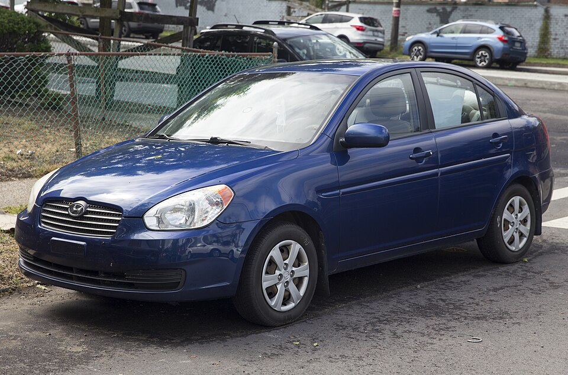
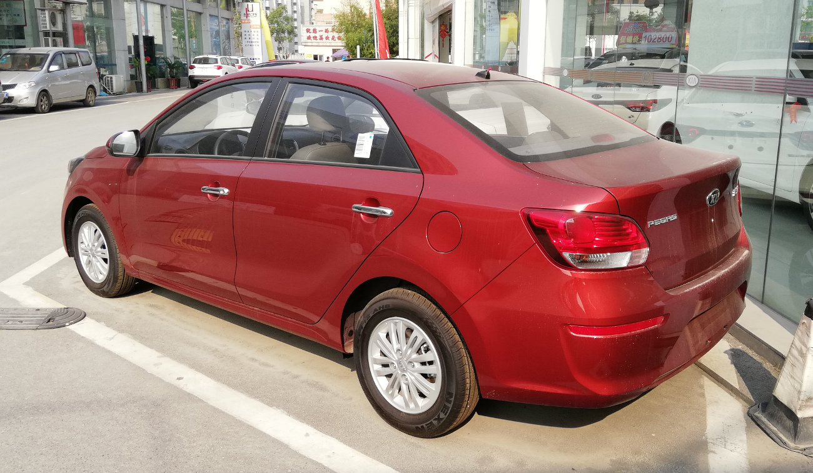
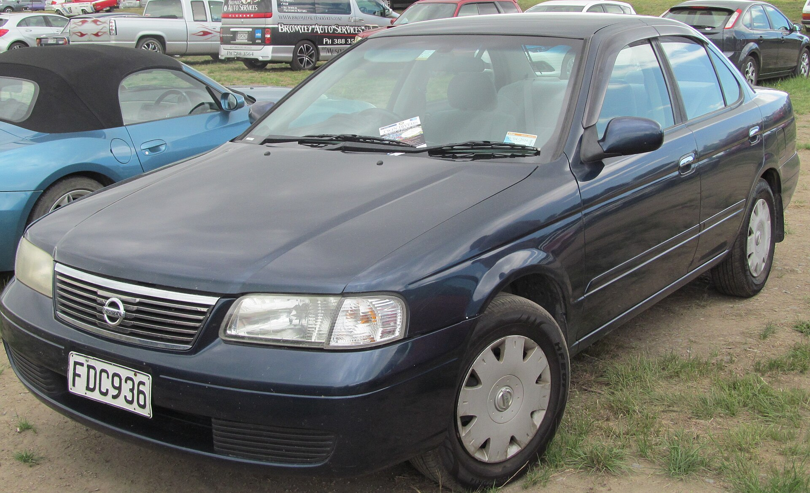
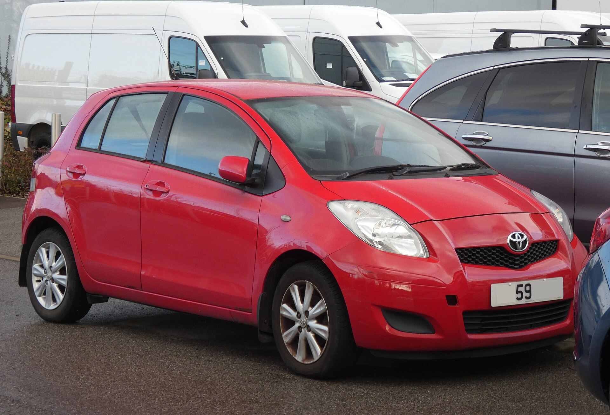
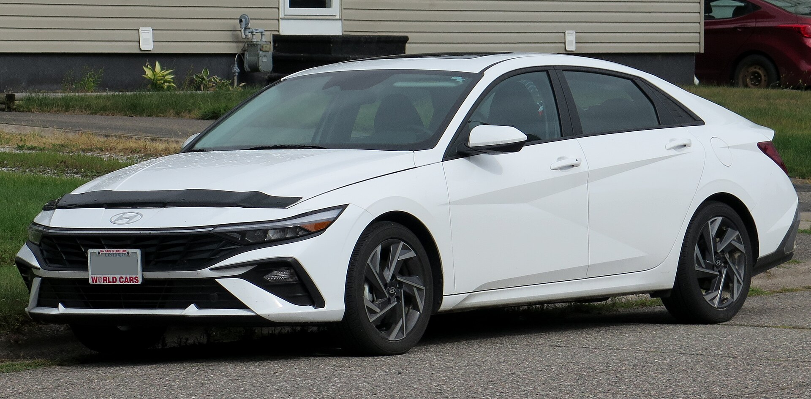
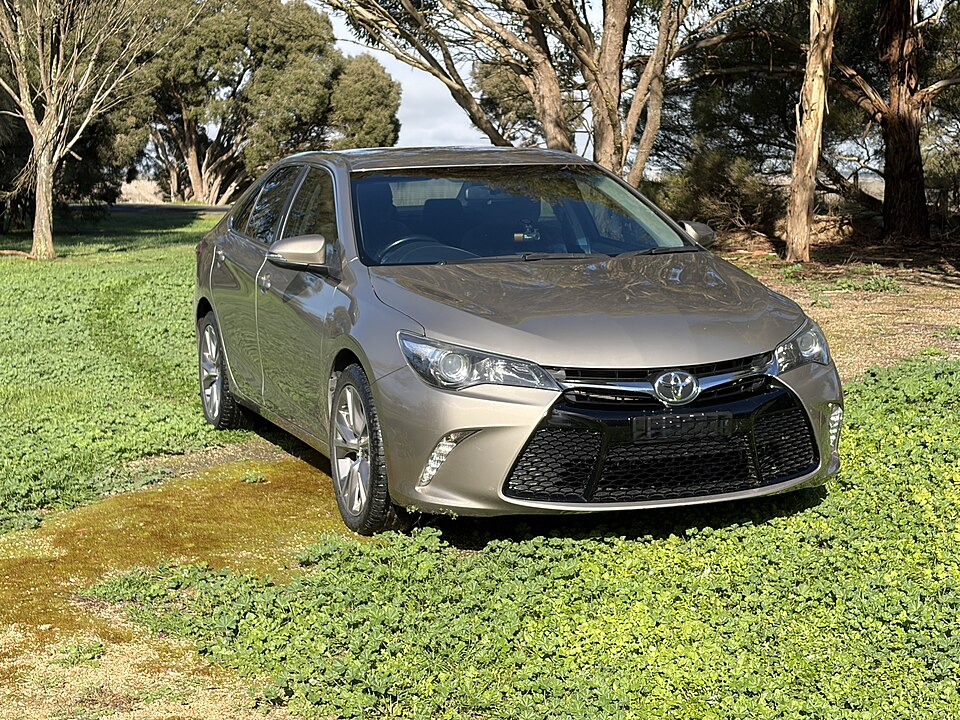
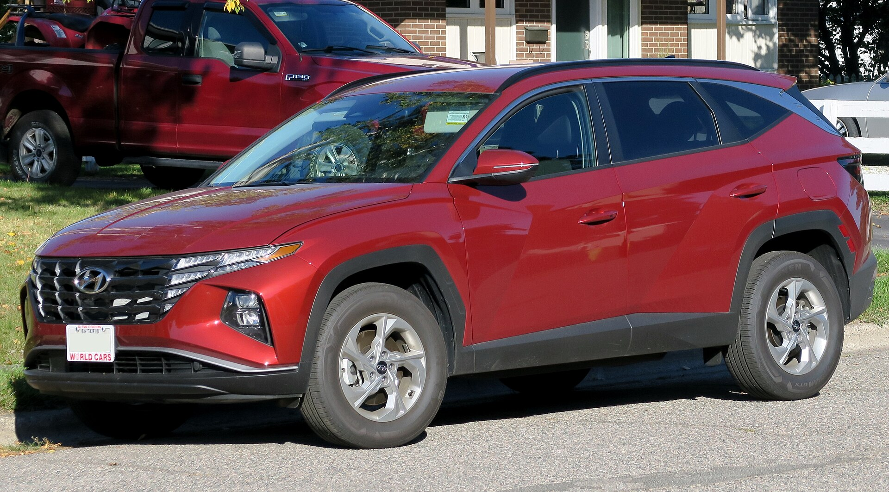
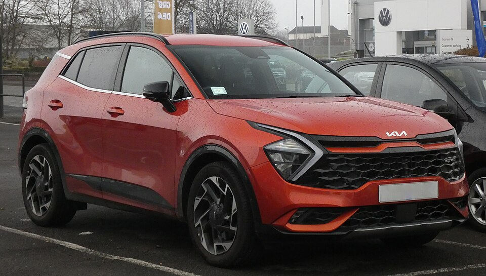
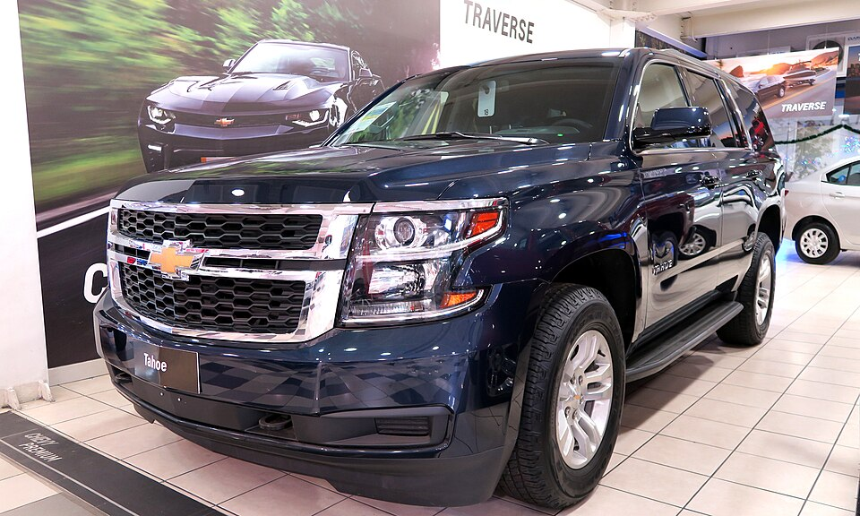
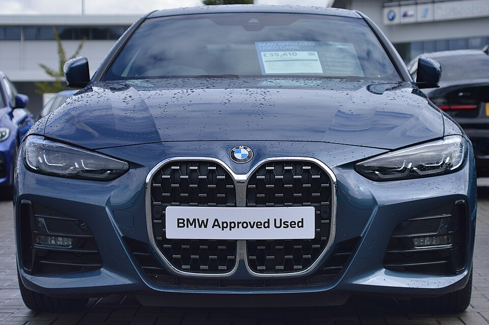

# 🚗 Car Rental Management System

A web-based car rental application built with **Laravel and PHP**, designed to organize vehicle listings, rental availability, bookings, and essential rental operations through a clean, user-friendly interface.

🔗 **Repository:** [Hebah Abdelwhab — Car Rental](https://github.com/hebah-abdelwhab26/car-rental)

---

## ✨ Features

- 🚘 **Vehicle Catalog** — Browse vehicles across different categories.
- 🔎 **Vehicle Details** — Explore vehicle information, specifications, and rental prices.
- 📅 **Availability Management** — Organize vehicle availability for rental periods.
- 🗂️ **Vehicle Categories** — Group vehicles into convenient categories.
- 📍 **Rental Locations** — Organize available rental locations.
- 🧾 **Booking and Order Management** — Maintain rental order information and statuses.
- 💳 **Payment Records** — Support the application's payment data structure.
- 🌐 **Localization** — Support for localized interfaces.
- 💬 **Comments and Reviews** — Manage customer feedback.
- 📱 **Responsive Interface** — Designed to provide a convenient browsing experience across screen sizes.

> Note: Available functionality depends on the current implementation and configuration. Payment gateway integration and production deployment should be verified separately.

---

## 🚙 Featured Fleet

The project includes a collection of 18 vehicle images organized into five categories.

### Economy Cars

| Hyundai Accent 2024 | Kia Pegas | Nissan Sunny | Toyota Yaris 2024 |
|---|---|---|---|
|  |  |  |  |

### Sedan Cars

| Hyundai Elantra | Kia K5 | Toyota Camry | Toyota Corolla |
|---|---|---|---|
|  |  |  |  |

### SUVs

| Ford Explorer | Hyundai Tucson | Kia Sportage | Toyota RAV4 |
|---|---|---|---|
|  |  |  |  |

### Family Cars

| Chevrolet Tahoe 2024 | Hyundai Santa Fe 2024 | Toyota Innova 2024 |
|---|---|---|
|  |  |  |

### Luxury Cars

| BMW 5 Series 2024 | Genesis G80 2024 | Mercedes-Benz E-Class 2024 |
|---|---|---|
|  |  |  |

---

## 🛠️ Technology Stack

- **Backend:** PHP, Laravel
- **Database:** MySQL
- **Frontend:** Blade templates, HTML, CSS, JavaScript
- **Localization:** Laravel localization support
- **Version Control:** Git and GitHub

---

## ⚙️ Installation and Setup

### Prerequisites

Make sure you have PHP, Composer, a supported database, and the required PHP extensions installed.

### 1. Clone the repository

```bash
git clone https://github.com/hebah-abdelwhab26/car-rental.git
cd car-rental
```

### 2. Install dependencies

```bash
composer install
```

### 3. Configure the environment

```bash
cp .env.example .env
php artisan key:generate
```

On Windows, you can copy `.env.example` to `.env` using File Explorer or PowerShell.

Update the database settings in `.env` to match your local database.

### 4. Run database migrations

```bash
php artisan migrate
```

If you want sample data, review the database seeders first. Some seeders create demonstration users and rental orders.

### 5. Start the development server

```bash
php artisan serve
```

Open the local URL shown in the terminal, usually:

```text
http://127.0.0.1:8000
```

---

## 🔐 Security Notes

- Never commit `.env` or production credentials.
- Configure a unique application key and secure database credentials.
- Review demo accounts and sample data before using the application in production.
- Configure production settings with debugging disabled.

---

## 👩‍💻 Author

**Hebah Abdelwhab**

Laravel Developer | Web Developer

- GitHub: [@hebah-abdelwhab26](https://github.com/hebah-abdelwhab26)

---

## 📄 License

Review the repository's license file before redistributing or reusing this project.

---

⭐ If you find this project interesting, feel free to explore the repository and its implementation.
